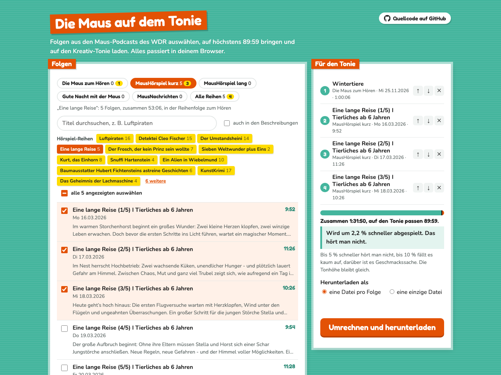

# Download automation of daily "Sendung mit der Maus" audio content
My son loves the Sendung mit der Maus, and so do I (since my early childhood, in fact).
The [Sendung mit der Maus](https://www.wdrmaus.de/) is an excellent series of educational and creative media published by the [Westdeutscher Rundfunk Köln (WDR)](https://www.wdr.de).
The format appears weekly on Television since 1971 and as a Stream.
Since the COVID-19 pandemic of 2020, there is also a series of freely streamable and as mp3 file downloadable daily audio plays.

For some weird reason however, in germany publicly funded and freely available media gets depublished after (approximately) one week of online availability. In the past, I have tried to keep track of the newly published episodes, but some slipped between my fingers. I therefore set out to create this small automation tool (which can be run as a cron job, for example) to automatically collect and download any newly appearing mp3 audio files.

With the newest iteration of this project (and my son's age-related loss of keen interest in Maus content), I shifted the focus from data preservation to tool usability and the publication as a readily available web service via GitHub Pages.

## In the browser: "Die Maus auf dem Tonie"

**https://sebastian-lapuschkin-sideprojects.github.io/gute-nacht-mit-der-maus-mp3-downloader/**



The page lists all episodes of the WDR's Maus podcasts that can be downloaded right now
("Die Maus zum Hören", "MausHörspiel kurz" and "lang", "Gute Nacht mit der Maus", "MausNachrichten"),
with their durations. The newest "Die Maus zum Hören" is selected; add, remove and reorder episodes as you like.
A search field filters the titles (optionally also the descriptions), and one checkbox selects all episodes shown.
Hörspiele that belong together (stories in several parts such as "Luftpiraten (1)" ... "(15)", and series such as
"KunstKrimi - ..." or "Kurt, das Einhorn: ...") are recognised by their titles and offered as buttons:
one click lists such a series in the order to listen to it, another click on the checkbox selects all of it.
If the selection is longer than 89:59, the page says by how many percent it will be played faster
(up to 5 % nobody notices, up to 10 % hardly, beyond that it is a matter of taste; the pitch stays the same).
More than twice the speed is not recommended, but the page leaves that decision to the user.
The button downloads the mp3 files from the WDR, speeds them up just enough to fit onto a
[Creative-Tonie](https://tonies.com/) (90 minutes) and offers one file per episode or one single file.

Everything runs in the browser, nothing is uploaded:

- the episode list comes from the GraphQL API of the [ARD Audiothek](https://www.ardaudiothek.de/) (it allows requests from any web page; the WDR's own podcast feeds do not),
- the mp3 files come straight from the WDR's media server,
- [Pyodide](https://pyodide.org/) runs the Python code ([maus.py](./maus.py) and [web.py](./web.py)),
- [ffmpeg.wasm](https://ffmpegwasm.netlify.app/) does the audio work: ffmpeg's `atempo` filter, as in [toniefy.py](./toniefy.py) (chained for more than twice the speed, as ffmpeg's documentation suggests), with up to three files converted at the same time. A 60 minute episode takes well under a minute.

If the selection fits as it is, the original WDR files are offered (numbered and renamed), without converting anything.
To run the page locally, serve the folder with any web server, e.g. `python -m http.server`, and open http://localhost:8000.
The two small wrapper files of ffmpeg.wasm (MIT license) are in [vendor/ffmpeg](./vendor/ffmpeg); ffmpeg itself is loaded from jsDelivr.

The page is an unofficial fan project and not an offering of the WDR. The pictures of the Maus and the elephant are shown directly from wdrmaus.de.

## The same on the command line

[cli.py](./cli.py) does what the page does, with a locally installed [ffmpeg](https://ffmpeg.org/) and no other packages:

  ```
  python cli.py list                       # all episodes that can be downloaded now
  python cli.py list kurz gutenacht        # only some series: zumhoeren kurz lang gutenacht nachrichten
  python cli.py convert                    # the newest "Die Maus zum Hören"
  python cli.py convert 11589029 16729631 --single -o toniefied
  ```

## The original tools

The scripts below are the original version of this project.
[main.py](./main.py) is built with python and uses selenium to request the full html source code of the php pages in order to extract and then download newly published mp3 files for safekeeping. Only the mp3 files not already present in the output directory will be downloaded. Existing files will be skipped.
Note that the WDR stopped the music podcast ("MausMix", content `musik`) on 2024-05-01 and "Gute Nacht mit der Maus" in July 2026,
so the daily podcast-plus-music pairs that [toniefy.py](./toniefy.py) was made for do not exist any more.

### Installation on Debian-based systems
For use with Firefox:
  ```
  sudo apt install -y firefox firefox-geckodriver
  ```

For use with Chrome/Chromium:
  ```
  sudo apt install -y chromium-browser chromium-chromedriver
  ```

Installing the required python (3.7 or above) packages
  ```
  pip install -r requirements.txt
  ```

Optional (for the use of [toniefy.py](./toniefy.py). See below)
  ```
  sudo apt install -y ffmpeg
  ```

### How to use

Everything is pretty straight forward, if you follow the documentation:

  ```
  $python main.py --help

  Usage: main.py [OPTIONS]

Options:
  -c, --content TEXT      What is the target content to download? pick
                          'gutenacht' (default) for 'Gute Nacht mit der Maus',
                          'hoerspiel' for 'Maus Hoerspiel', i.e. stories etc,
                          'podcast' for a full hour Maus podcast (i.e. the
                          listen-only-equivalent of the regular weekly
                          'Sending mit der Maus' episodes on TV or Stream, or
                          'musik' for content all about music. This content
                          selection will create a correspondingly named folder
                          in your choice of output directory.
  -b, --browser TEXT      Which browser to use for? Pick between 'firefox' and
                          'chrome' (default).
  -w, --waittime INTEGER  Time in seconds to allow the browser to request
                          resources and render. Default wait time is 10
                          seconds.
  -o, --output TEXT       The output directory to create (if required) and
                          write the discovered files into. Default output
                          directory is '.'.
  --help                  Show this message and exit.
  ```

### Toniebox-readification

The daily podcast and music episodes are thematically aligned and of roughly 60 and 30 minutes of duration, respectively. If you own a [Toniebox](https://tonies.com/) with a [Creative Tonie](https://tonies.com/en-gb/creative-tonies/), which comes with 90 minutes of capacity to play back custom content, you can conveniently select (and slightly preprocess) a podcast with matching musical content using [toniefy.py](./toniefy.py).
Since together the podcast and music files of a day of choice typically slightly exceed the 90 minute capacity of the Creative Tonie, [toniefy.py](./toniefy.py) infers the minimal required increase in playback speed and then uses [ffmpeg](https://ffmpeg.org/) to process the files to not exceed the figurine's capacity when uploaded together. Note that in order to use this script, [ffmpeg](https://ffmpeg.org/) needs to be installed on the executing device (see installation instructions above.)

Follow the instructions, by providing the YEAR, MONTH and DAY corresponding to the publication of your previously with [main.py](./main.py) downloaded Maus-episodes as digits. The script will output processed mp3-files to a (default) location (of choice) which can then be uploaded to the Tonie via your Toniebox-account.

```
Usage: toniefy.py [OPTIONS] YEAR MONTH DAY

  (1) Takes the podcast and music mp3 files corresponding to a given date
  string (which usually are topically aligned), (2) measures their length in
  time (usually slightly over 90 minutes in length when added up) (3) and then
  uses ffmpeg to change playback speed to get just under 90 minutes of play
  time. (4) the end result can then be uploaded conveniently to a "Creative-
  Tonie" (with 90min capacity) for Toniebox-playback. see
  https://tonies.com/en-gb/creative-tonies/

Options:
  -o, --output TEXT     The output location of choice. Default is
                        "./toniefied"
  -s, --sourcedir TEXT  The source directory in which to scan for content.
                        Default is "."
  -d, --discover_only   If specified, discovered source file stats will be
                        displayed, but no output will be generated.
  --help                Show this message and exit.
```

### Filename cleanup

From time to time, the mp3-files provided on the Maus streaming page change naming patterns. This may slip through and a lot of content might be downloaded before this change in naming convention is discovered. For this reason, I provide [renamer.py](./renamer.py), which can be used to post-hoc clean up the downloaded files' names in order to increase clarity of naming.
The current renaming policies in this file are reflected in the main executable [main.py](./main.py) as well, affecting any future downloads.